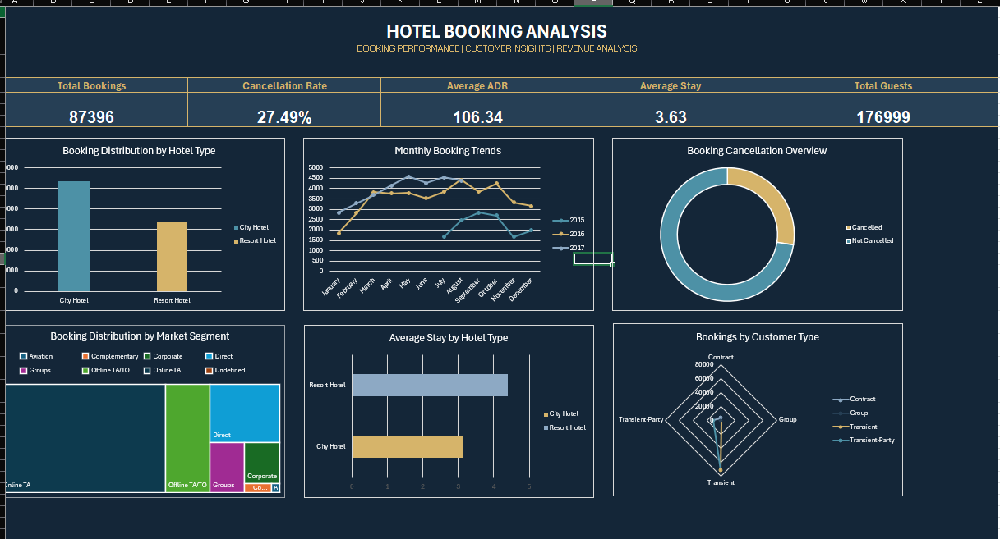

# Hotel Booking Analysis – Excel Dashboard

## Project Overview
This project focuses on analysing hotel booking data using Microsoft Excel. An interactive dashboard was developed to explore booking trends, cancellation patterns, customer behaviour, and hotel performance.

## Dataset
- Dataset: Hotel Booking Demand
- Original Records: 119,390
- Original Columns: 32

## Tools Used
- Microsoft Excel
- Excel Tables
- PivotTables
- Excel Formulas
- Excel Charts
- Dashboard Design

## Data Cleaning and Preparation
- Removed duplicate records.
- Converted the dataset into an Excel Table.
- Created calculated columns:
  - Total_Nights
  - Total_Guests
  - Arrival_Month_No
  - Cancellation_Status

## Key Performance Indicators (KPIs)
1. Total Bookings: 87,396
2. Cancellation Rate: 27.49%
3. Average ADR: 106.34
4. Average Stay: 3.63 nights
5. Total Guests: 176,999

## Dashboard Visualisations
1. Booking Distribution by Hotel Type – Bar Chart
2. Monthly Booking Trends – Line Chart
3. Booking Cancellation Overview – Doughnut Chart
4. Booking Distribution by Market Segment – Treemap
5. Average Stay by Hotel Type – Bar Chart
6. Bookings by Customer Type – Radar Chart

## Skills Demonstrated
- Data Cleaning
- Data Analysis
- PivotTable Creation
- Excel Formulas
- KPI Development
- Data Visualisation
- Dashboard Development

## Dashboard Preview

## Conclusion
This project helped me practise Excel data analysis techniques and transform raw hotel booking data into an interactive dashboard for understanding booking patterns and customer behaviour.

